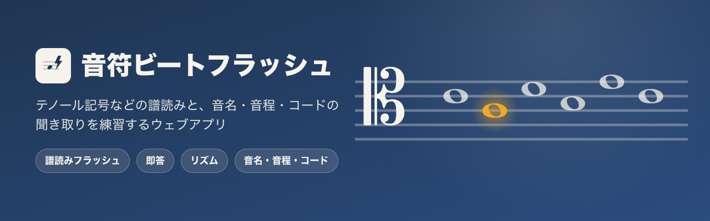
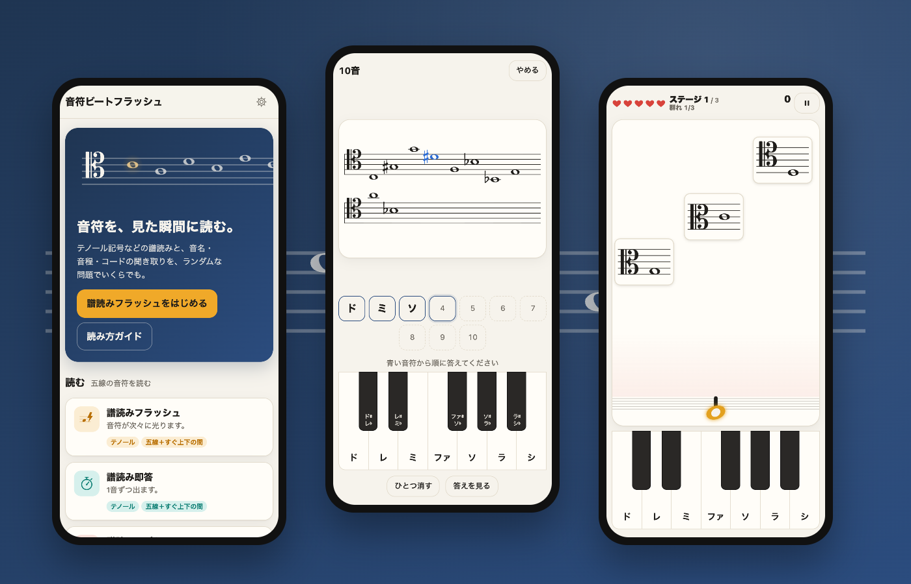

# 音符ビートフラッシュ

**遊ぶ: https://lutelute.github.io/onpu_beat_flash/**

譜読み（テノール記号などのハ音記号・ト音・ヘ音）と、音名・音程・コードの聞き取りを、ランダムな問題でいくらでも練習できるウェブアプリ。インストール不要で、一度開けばオフラインでも使える（PWA）。



## 遊べるもの

| ゲーム | 中身 |
|---|---|
| 譜読みフラッシュ | 音符が次々に光り、消えたあと出た順に答える（フラッシュ暗算の形）。「消えずに並ぶ」表示、「もう一度見る」「答えを見る」も。自由練習と検定（10級→五段） |
| 譜読み即答 | 1音ずつ、できるだけ速く答える。30秒・60秒・20問・50問・エンドレス |
| 譜読みリズム | 右から流れてくる音符を、縦の線に重なった瞬間に鍵盤で答える。当たると音符の音が鳴る |
| オトバトル | 降りてくる敵の五線を読み、その音を答えて撃つ。砦に届かれるとハートが減る。ステージの最後はフレーズを持ったボス（左から順に答えると削れる）。外すと少し撃てなくなるので、連打では勝てない。もとの OtoBattle の遊び方（真ん中の砦へ四方から迫る・照準で狙う・面ごとに音部記号や ♯ が増える「だんだん広がる」・音ごとの色分け）も選べる。音符が少しのあいだだけ見える「フラッシュ」表示（ボスのフレーズは 1 音ずつ光る。Space でもう一度見る）と、群れごとに速さを合わせる「おまかせ」もある |
| リズム練習 | リズム譜（四分〜十六分・付点・シンコペーション・休符）を見て、メトロノームに合わせて叩く。お手本を先に聞ける。型ごとの得意・苦手とタイミングのずれが分かる |
| 音名当て | 鳴った音の名前。基準の音（ド・ラ）あり／なし、幹音だけ／12音 |
| 音程当て | 2音の隔たり。上行・下行・同時。間違えたら選んだ音程と聞き比べ |
| コード聞き取り | メジャー・マイナーからセブンス系まで11種。転回形あり |

- **音部記号**: テノール・アルト・ソプラノ・メゾソプラノ・バリトン（ハ音記号）、ト音、ヘ音。2つ以上選ぶと1音ごとに入れ替わる
- **臨時記号**: なし／♯／♭／両方。ファ♯とソ♭のような同じ高さの音は、どちらで答えても正解
- **答え方**: 音名で／鍵盤で高さまで（オクターブの読み違いを直す練習）
- **音名の呼び方**: ドレミ・ドイツ音名・英米音名・日本音名
- **苦手を多めに出す**、記録の画面（正答率・平均時間・よく間違える答え）
- **問題番号**で同じ問題をもう一度。**設定と問題をリンクで共有**（授業・レッスンで同じ問題を配れる）
- **入力**: タップ・キーボード（C〜B／H、Shift で ♯、数字で選択肢）・MIDI 鍵盤（Chrome・Edge）・**マイク**（楽器を弾くか歌って答える。楽器を選ぶとその音域だけを聞き、ギター・コントラバスは楽譜に書く高さで受け取る。アプリの音が鳴っているあいだは聞かない。イヤホンなら止めない設定も。感度は 5 段で、周りの音を測って部屋に合わせることもできる）
- **読み方ガイド**: 音部記号ごとの早見表と、テノール記号の読み方のコツ
- **アカウント**（なくても遊べる）: 釣りすごろくと同じユーザー名とパスワードでログインすると、成績と自己ベストがアカウントに残り、ほかの端末でも続きから練習できる。2 台で別々に練習した分は合計される
- **記録の書き出し・読み込み・全消去**。ログインしていなければ、記録は端末のブラウザの中だけに保存し、どこにも送らない
- 明るい画面・暗い画面、スマホ・タブレット・パソコン

## 動かし方

Node.js 20.19 以上（または 22.12 以上）。

```sh
npm install
npm run dev      # 開発用サーバー http://localhost:5317/
npm test         # 生成器・設定の検査・リズム判定のテスト（Node だけで動く）
npm run e2e      # 本番と同じビルドを手元の Google Chrome で通しで動かす（全ゲーム・オフライン・壊れた保存データなど）
npm run e2e:mic  # 偽マイクに WAV を流して、マイクで答えられるかを確かめる
npm run e2e:account  # アカウント（登録・ログイン・別の端末・ログアウト）を、偽のアカウントで通しで動かす
npm run e2e:emu  # Firebase につなぐ部分を、手元のエミュレータで確かめる（Java 21 以上が要る。初回はエミュレータを取ってくる）
npm run e2e:share  # 公開中の釣りすごろくと同じ場所に置いて、ログインが行き来するかを確かめる（エミュレータで。ネットが要る）
npm run build    # dist/ にできる。どこのフォルダに置いても動く
npm run icons    # アプリのアイコン（public/icon-*.png など）を作り直す
npm run art      # バナー（public/og.png、docs/banner.png・square.png・screens.png）を作り直す
```

`npm run e2e` は手元の Google Chrome を使う。場所が違うときは `CHROME=/path/to/chrome npm run e2e`。画面を出して見るときは `HEADFUL=1`。

## アカウント

釣りすごろく（`../tsuri_sugoroku`）と同じ Firebase のプロジェクト（`tsuri-sugoroku`）を使う。向こうで作ったアカウントでそのまま入れ、こちらで作ったアカウントは向こうでも使える。

- **決まりは釣りすごろくと揃えてある**（`src/core/account.js`。向こうは `src/store/useAuthStore.ts`）。ユーザー名は小文字にして `@tsuri.local` を付けたメールアドレスとして登録する。24 時間使わないと自動でログアウトする（`localStorage` の `tsuri_session_at`）。ゲスト（`guest@tsuri.local`）は端末の記録のまま。片方を変えるときは、もう片方も変える
- **アカウントに置くもの**: 成績と自己ベスト（検定の級を含む）だけ。Firestore の `users/{uid}/data/onpuBeatFlash` に、1 つの文字列（JSON）にまとめて置く。釣りすごろくの `firestore.rules`（`users/{uid}/` 以下はログインしていれば読み書きできる）のままで動くので、ルールを出し直す必要はない
- **設定は端末ごと**（音量・明るさ・MIDI・マイク・ゲームごとの設定）。アカウントには入れない
- **ログインする前の記録**は、ログインしても勝手には混ざらない。アカウントの画面の「アカウントに足す」で移す（家族で同じ端末を使っていても、ほかの人の記録が入らないように）
- **つながらないとき**は、アカウントごとの入れ物（`localStorage`）に書いておき、つながったら送る。送るのは「この端末で増えた分」なので、2 台で別々に練習しても、どちらの分も残る
- Firebase の部品は別のファイルに分かれ、画面が出たあとで読み込む。読み込めなくても遊べる。確かめているあいだ（最長 8 秒）は、アカウントの画面にログインの入力欄を出さない
- 釣りすごろくの側を変えたら `npm run e2e:share` を走らせる（公開中の釣りすごろくを写して、ログインが行き来するかを見る）

## 公開する

https://lutelute.github.io/onpu_beat_flash/ に GitHub Pages で公開している（リポジトリ `lutelute/onpu_beat_flash`）。`main` に push するたびに `.github/workflows/deploy.yml` がテストしてから公開する。

- 釣りすごろく（`https://lutelute.github.io/Tsuri_sugoroku/`）と同じ `lutelute.github.io` の下にあるので、ログインの状態が 2 つのゲームで共有される（片方でログインすれば、もう片方もログイン中。ログアウトも同じ）。Firebase がログインを覚える場所（IndexedDB）と、24 時間の期限の時刻（`localStorage` の `tsuri_session_at`）が、同じ場所で公開したページどうしで共有されるため。別の場所で公開しても、同じユーザー名とパスワードで入れる
- `dist/` は相対パスで作っているので、ほかの静的なサーバーに置いても動く。Service Worker を使うので https か localhost で配る
- SNS に貼ったときのバナーは `public/og.png`（`index.html` の `og:image` は公開先の絶対 URL）

## 構造

問題を **生成器**（何を出すか）と **遊び方**（どう出すか）に分けてある。ゲームはその組み合わせ。

```
src/
  core/            画面に触らない部分（Node でテストできる）
    music.js         音の高さ・音部記号・範囲・音名・音程・和音・綴り
    rng.js           種つきの乱数（同じ種 → 同じ問題の並び）
    settings.js      保存してある設定を、設定項目の定義に照らして確かめる
    globals.js       共通の設定（呼び方・音・明るさ・MIDI）の定義
    store.js         設定・成績・自己ベストの保存（localStorage）、書き出し・読み込み。成績と自己ベストは、ログイン中はアカウントごとの入れ物に置く
    account.js       アカウントの決まり（釣りすごろくと同じ：ユーザー名 → メールアドレス、24 時間の期限、失敗の文言）
    sync.js          記録をアカウントと合わせる計算（前に合わせた中身・この端末・アカウントの 3 つを見比べ、この端末で増えた分を足す）
    rhythmEngine.js  リズムの判定（時刻を渡すと Perfect/Great/Good/Miss）
    pitch.js         マイクの音の高さ（McLeod の方法・FFT）と、音の区切り（弾き直し・ビブラート・すぐ消える音）、楽器ごとの聞く範囲
    battleEngine.js  オトバトルの進行と判定（敵の出現・降下・隊列・ボス・命中・外れ・突破・ステージ・重なりの先読み・おまかせの速さ）。画面には触らない
    battleLayout.js  オトバトルの並べ方（画面の大きさ → 敵・砦・ボスの大きさと位置、四方からの通り道）。絵とテストが同じ計算を使う
  generators/      生成器。設定と乱数から 1 問ずつ作る
    index.js         約束（Generator / Question）の説明と一覧
    reading.js       譜読み（臨時記号つき）
    rhythmPattern.js リズム練習（拍の「型」を組み合わせて小節を埋める）
    pitch.js         音名当て
    interval.js      音程当て
    chord.js         コード聞き取り
    common.js        選び方（直前と同じものを避ける・苦手の重み）
  modes/           遊び方。生成器の約束だけを見て動く
    flash.js         光らせて、あとでまとめて答える（検定つき）
    quiz.js          1問ずつ答える（譜面の問題にも音の問題にも使う）
    rhythm.js        流れてくる音符にタイミングよく答える
    tap.js           リズム譜を見て叩く（リズム練習）
    battle.js        降りてくる五線の音を答えて撃つ（オトバトル。照準・「だんだん広がる」コース）
    common.js        設定の画面・結果の内訳・苦手の重みの写し
    share.js         設定と問題番号をリンクにする
  render/
    staff.js         VexFlow で五線と音符を SVG にする
    rhythmScore.js   リズム譜（線 1 本の打楽器譜）と、拍 → 横の位置
    battleCanvas.js  オトバトルの絵（canvas。下の 4 つを組み合わせて 1 コマを描き、命中・突破などを演出にする）
    notation.js      canvas に楽譜を描く（五線・音部記号・全音符・加線・臨時記号。位置の計算はテスト済み）
    battleMonsters.js オトバトルの敵の姿（五線の札を抱えた怪物。表情・まばたき・爪・牙）
    battleScenery.js オトバトルの景色（面ごとの空・城・森・鍵盤の柱・夕焼け・とげの城・星空、砦の石垣、漂う音符や火の粉）。変わったときだけ描き直す
    glyph.js         Bravura の字形を path にする（DOM なし。アイコン・バナーの書き出しでも使う）
    audio.js         Web Audio のピアノの音（倍音ごとの減衰・弦のずれ・打鍵の音・残響）・メトロノーム
  art/banner.js      バナーの絵（ホームのバナーと書き出す画像で共通）
  ui/
    form.js          設定項目の定義から設定画面を組み立てる
    pads.js          答えのボタン・鍵盤（キーボード・MIDI からも押せる）
    battleHud.js     オトバトルの上の表示（ハート・進み具合・点数）と見出し・一時停止
    midi.js          MIDI 鍵盤（マイクの音もここを通る）
    mic.js           マイク（聞こえた音を MIDI 番号にして、MIDI 鍵盤と同じ道で渡す）
    dom.js           画面づくりの小道具と、画面 1 枚ぶんの寿命（キー操作・タイマーの片づけ）
    icons.js         アイコン（音楽の記号の字形を使う）
    toast.js theme.js
  account/
    account.js       ログインの状態と、記録をアカウントと合わせる段取り（いつ送るか・つながらないとき）
    backend.js       Firebase（釣りすごろくと同じプロジェクト）につなぐ部分。画面が出たあとで読み込む
  screens/         ホーム・読み方ガイド・記録・設定・アカウント・このアプリについて
  games.js         ゲームの一覧（生成器 × 遊び方）
  main.js          画面の切り替え（#/、#/game/<id>、#/guide、#/stats、#/account、#/about）
  sw-template.js   Service Worker の元（ビルドで出力ファイルの一覧を埋めて dist/sw.js にする）
tests/             生成器・設定・リズム判定・オトバトルの進行・音の高さのテスト、e2e/ にブラウザの通しのテスト（mic.mjs は偽マイクに WAV を流す。account.mjs は偽のアカウント、account-emu.mjs は Firebase のエミュレータ、share.mjs は釣りすごろくとのログインの共有）
scripts/           アイコン・バナーを作る
docs/              README の画像
extras/            元の OtoBattle の公開ページから、ここのオトバトルへ案内するページ（使い方は中の README）
```

### ゲームを足すには

- **同じ問題を別の遊び方で**: `games.js` の `GAMES` に 1 行足す
- **新しい種類の問題**: `generators/` に生成器を 1 つ書いて `generators/index.js` に登録し、`games.js` に足す。生成器が守る約束は `generators/index.js` の先頭にある。設定画面は `fields` から自動でできる。保存してある設定もその定義で検査される
- `tests/generators.test.js` は、登録した生成器で 2000 問ずつ作って約束を守っているかを確かめる。新しい生成器も `SETTINGS` に設定を足せば同じ検査が走る

## ライセンス

使っている部品:

- [VexFlow](https://github.com/vexflow/vexflow) 4.2.5 — MIT License
- [Bravura](https://github.com/steinbergmedia/bravura)（VexFlow に含まれる音楽記号の字形）— SIL Open Font License 1.1

このアプリ自体のライセンスは未定（公開する人が決める）。
